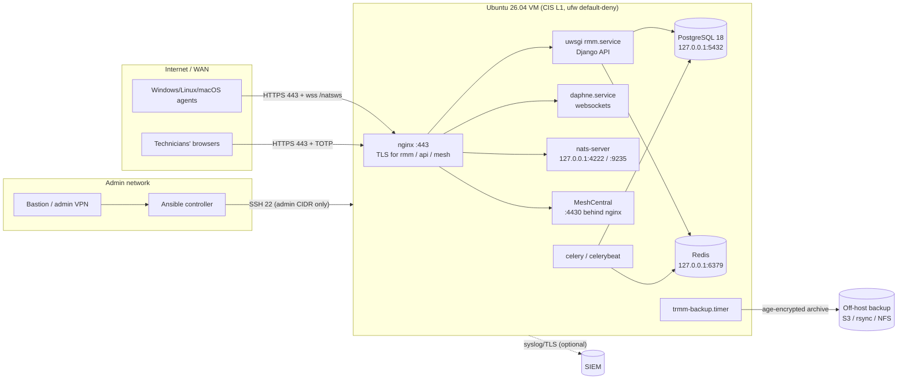

# Tactical RMM on Ubuntu 26.04 – Infrastructure as Code

Repeatable, CIS-hardened deployment of a [Tactical RMM](https://docs.tacticalrmm.com/)
server with Ansible. One playbook (`site.yml`) takes a fresh Ubuntu 26.04 VM
through **baseline → TRMM install → CIS Level 1 hardening → verification**, with
before/after compliance reports.

> **Status:** v1.0.0 – static gates pass (yamllint, ansible-lint production
> profile, shellcheck, syntax-check, gitleaks). **Not yet run against a real
> VM** – follow [First run](#first-run-check-mode-first) on a throwaway VM first.

## Versions and sources (verified 2026-11-07)

| Component | Version / pin | Source |
|---|---|---|
| Tactical RMM | **v1.6.1** (commit `086e2d97`); installer `install.sh` SCRIPT_VERSION 93, SHA-256 `51648ba5…0e70` | [Install docs](https://docs.tacticalrmm.com/install_server/), [release notes](https://github.com/amidaware/tacticalrmm/releases) – v1.6.0 added "Debian 13 and Ubuntu 26.04 support" |
| Installer OS gate | `Only Debian 13 and Ubuntu 26.04 are supported` – **accepts 26.04, not modified** | `install.sh` at v1.6.1 |
| CIS benchmark | **CIS Ubuntu Linux 26.04 LTS Benchmark v1.0.0**, Level 1 – Server | [cisecurity.org](https://www.cisecurity.org/benchmark/ubuntu_linux) |
| CIS role | `ansible-lockdown/UBUNTU26-CIS` **0.9.0**, commit `9746233c` ("CIS v1.0.0 – Initial release", 2026-11-02) | [GitHub](https://github.com/ansible-lockdown/UBUNTU26-CIS) |
| CIS audit content | `UBUNTU26-CIS-Audit` branch `benchmark_1.0.0`, commit `30675914`; `syver` v0.15.1 (checksum-pinned by the role) | [GitHub](https://github.com/ansible-lockdown/UBUNTU26-CIS-Audit) |
| OpenSCAP / SSG | **Not usable**: SSG 0.1.82 ships `ubuntu2604` with only a `default` profile, no CIS profile | [ComplianceAsCode](https://github.com/ComplianceAsCode/content/tree/master/products/ubuntu2604) |
| Controller | ansible-core 2.22.0, ansible-lint 26.11.0, collections pinned in `requirements.yml` | `requirements*.txt/yml` |

## Architecture



Details, trust boundaries and file locations: [docs/architecture.md](docs/architecture.md).

### Ports and flows

| Port | Direction | Source → destination | Purpose | Firewall |
|---|---|---|---|---|
| 443/tcp | in | agents, technicians → nginx | Web UI, API, MeshCentral, agent NATS **over websocket** (`wss://api…/natsws`) | allowed from `trmm_https_allowed_cidrs` |
| 22/tcp | in | bastion/admin CIDR → sshd | Administration (key-only) | allowed from `admin_ssh_cidrs` only |
| 4222/tcp | – | loopback | NATS standard port; **bound to 127.0.0.1** on a standard install, agents never connect to it | **closed** (toggle `trmm_firewall_allow_nats_standard` for legacy mode only) |
| 9235, 4430, 800, 5432, 6379 | – | loopback / behind nginx | NATS-ws, MeshCentral, PostgreSQL, Redis | closed (default deny) |
| 80/tcp | – | – | nginx redirect vhost created by the installer; not needed with DNS-01 | closed |
| 443, 80, 53, 123/udp | out | server → Internet | GitHub, PyPI, npm, nginx.org, PGDG, NodeSource, Let's Encrypt, Ubuntu archive, DNS, NTP | outbound allowed (CIS 4.1.4 is L2, not adopted – EXC-04) |
| 587 (example) | out | server → SMTP relay | Alert e-mail | outbound allowed |
| S3 443 / SSH 22 / NFS 2049 | out | server → backup target | Off-host backups | outbound allowed |
| 6514/tcp (example) | out | server → SIEM | Log forwarding (optional) | outbound allowed |

> The brief listed 4222 as the agent port. TRMM ≥ 1.x agents use NATS over
> websocket on 443; `nats-rmm.conf` binds 4222 to `127.0.0.1` unless
> `USE_NATS_STANDARD` is set (source: `tacticalrmm/helpers.py` at v1.6.1).
> The verify playbook asserts this.

## Repository layout

```
ansible.cfg, requirements.yml, requirements-dev.txt   pinned toolchain
inventory/hosts.example.yml                           copy -> hosts.yml (gitignored)
inventory/examples/{site.yml,vault.yml}               copy -> group_vars/all/ (gitignored)
inventory/group_vars/all/main.yml                     shared pins and toggles (committed)
playbooks/site.yml                                    full run
playbooks/01-baseline.yml … 04-post-hardening-verify.yml
playbooks/audit.yml                                   Lynis + CIS audit (before/after)
playbooks/trmm-{backup-now,upgrade,restore}.yml       operations
roles/baseline         preflight gates, packages, users, SSH, chrony, journald, patching, release-upgrade block
roles/trmm_firewall    ufw (single firewall manager)
roles/trmm_server      official installer, TLS, credentials, SMTP, health check, log inputs
roles/trmm_backup      nightly encrypted off-host backup with the latest official backup.sh
roles/cis_level1       wraps UBUNTU26-CIS with every control set explicitly
docs/                  architecture, CIS exceptions, runbook, change record, compliance mapping
scripts/               bootstrap-dev, lint, audit, idempotence, gen-cis-vars
```

**Deviations from the requested layout (and why):**

- Example variable files live in `inventory/examples/`, not
  `group_vars/all/vault.example.yml`. Ansible loads *every* `.yml` in
  `group_vars/all/`, so committed placeholders there would silently fill any
  key missing from the real files.
- Site values are split from `main.yml` into a gitignored `site.yml`, because
  real FQDNs/IPs must not be committed.
- `99-rollback-notes` is documentation only ([runbook §Rollback](docs/runbook.md#rollback-99-rollback-notes)).
  A playbook cannot safely roll back a CIS run or a TRMM install; snapshot revert can.
- Extra playbooks: `audit.yml`, `trmm-backup-now.yml`, `trmm-upgrade.yml`, `trmm-restore.yml`.
- No Molecule scenario. CIS hardening needs a real kernel, systemd, mounts,
  AppArmor and reboots, which containers don't faithfully provide. The tested
  path is a throwaway 26.04 VM with snapshot-and-revert
  ([runbook §Test VM](docs/runbook.md#test-on-a-throwaway-vm-snapshot-and-revert))
  plus `scripts/idempotence.sh`.

## Prerequisites

**Target VM**

- Fresh **Ubuntu Server 26.04 LTS** x86_64 (or aarch64), not LXC, not Turnkey, nothing else installed.
- Recommended for ≤ 500 agents: 4 vCPU / 8 GB RAM / 130 GB. TRMM's minimum is 4 GB RAM.
  Recommended LVM layout, so the CIS mount-option controls can apply:

  | Mount | Size | Options applied by CIS |
  |---|---|---|
  | `/` | 40 GB | – (TRMM in `/rmm`, `/meshcentral`) |
  | `/home` | 5 GB | nodev, nosuid |
  | `/var` | 30 GB | nodev, nosuid (PostgreSQL data) |
  | `/var/tmp` | 10 GB | nodev, nosuid, noexec (`backup.sh` staging: ≥ 2× one backup) |
  | `/var/log` | 10 GB | nodev, nosuid, noexec |
  | `/var/log/audit` | 10 GB | nodev, nosuid, noexec |
  | `/rmmbackups` | 30 GB | (local encrypted backups, 7 days) |
  | `/tmp` | tmpfs (default `tmp.mount`) | nodev, nosuid, noexec via unit |

- An admin account created at install time (SSH key + password for sudo); a static IP.
- DNS: `rmm`, `api`, `mesh` A/AAAA records at the same depth under one root domain.
- A VM snapshot capability (vSphere/OpenStack) for every change.

**Controller (Linux):** Python ≥ 3.12, `git`, `curl`. Then run `scripts/bootstrap-dev.sh`.

## Quick start

```bash
git clone <REMOTE_URL> trmm-iac && cd trmm-iac
scripts/bootstrap-dev.sh && source .venv/bin/activate
pre-commit install

# 1. Vault password (outside the repo), used for vault.yml AND generated credentials
mkdir -p ~/.config/trmm && openssl rand -base64 48 > ~/.config/trmm/vault-pass
chmod 600 ~/.config/trmm/vault-pass
export ANSIBLE_VAULT_PASSWORD_FILE=~/.config/trmm/vault-pass

# 2. Inventory and site values
cp inventory/hosts.example.yml inventory/hosts.yml
cp inventory/examples/site.yml  inventory/group_vars/all/site.yml
cp inventory/examples/vault.yml inventory/group_vars/all/vault.yml
$EDITOR inventory/hosts.yml inventory/group_vars/all/site.yml inventory/group_vars/all/vault.yml
ansible-vault encrypt inventory/group_vars/all/vault.yml

# 3. Gates
scripts/lint.sh
ansible trmm_servers -m ansible.builtin.ping
```

## First run (check mode first)

Snapshot the VM, then run:

```bash
# A. Dry run of the baseline (preflight gates run for real, read-only)
ansible-playbook playbooks/01-baseline.yml --check --diff

# B. Apply baseline + firewall
ansible-playbook playbooks/01-baseline.yml --diff

# C. TRMM: check mode validates the pin, TLS inputs and certificate; the
#    installer itself only runs in the real pass (15-40 min)
ansible-playbook playbooks/02-trmm-install.yml --check --diff
ansible-playbook playbooks/02-trmm-install.yml
ansible-vault view credentials/<host>.vault.yml      # superuser, TOTP secret, Mesh admin

# D. Evidence before hardening
scripts/audit.sh before

# E. Snapshot again, then CIS (may reboot)
ansible-playbook playbooks/03-cis-level1.yml --check --diff   # vendor role: check mode "not guaranteed"
ansible-playbook playbooks/03-cis-level1.yml --diff

# F. Verify + evidence after hardening
ansible-playbook playbooks/04-post-hardening-verify.yml
scripts/audit.sh after

# G. Idempotence: the second full run must report changed=0
scripts/idempotence.sh playbooks/site.yml
```

Afterwards, `ansible-playbook playbooks/site.yml` reruns everything.

## Agent onboarding

1. Sign in at `https://<rmm fqdn>` with the superuser and TOTP from `credentials/<host>.vault.yml`.
2. Create technician accounts (each user must enrol TOTP at first login), then rotate or disable the bootstrap superuser per your policy.
3. **Agents → Install Agent**: choose client/site, agent type (server/workstation), architecture, expiry. Download the installer or copy the PowerShell/CLI command.
4. Deploy through GPO, Intune or your software distribution tool. Agents need outbound **TCP 443** to the `api` and `mesh` FQDNs only.
5. Check the agent in the dashboard. If it shows offline, check DNS resolution of `api`/`mesh` from the endpoint and TLS interception on the path.

Agent deployment links need a publicly trusted certificate (they don't work with `--insecure`).
With an internal CA (`own_cert`), every endpoint must trust that CA.

## Assumptions

The environment fields in the brief were left as placeholders. Every one is a variable, and the preflight refuses to run while placeholders remain:

| # | Assumption | Where to change |
|---|---|---|
| A1 | Hypervisor-agnostic; snapshots are taken by the operator (vSphere/OpenStack commands in the runbook) | runbook |
| A2 | TLS via Let's Encrypt DNS-01 using a certbot DNS plugin (`cloudflare` in the example); `own_cert` supported for an internal CA | `trmm_tls_mode` |
| A3 | Internet-facing on 443 for roaming agents; SSH only from a bastion/admin CIDR | `trmm_https_allowed_cidrs`, `admin_ssh_cidrs` |
| A4 | Off-host backups to S3-compatible storage (rsync/SSH and NFS also implemented) | `trmm_backup_destination` |
| A5 | No SIEM yet: forwarding is built but off (open exception EXC-03) | `siem_*` |
| A6 | Ubuntu 26.04 defaults (sudo-rs, uutils coreutils, chrony, ufw, OpenSSH 10.2, tmpfs `/tmp`) were verified on a 26.04.1 system. The preflight re-detects them on the target and writes `reports/<host>-preflight.json` | – |
| A7 | Single server (the TRMM standard install has no HA); DR = restore to a fresh VM | runbook |
| A8 | Git remote placeholder `<REMOTE_URL>`; nothing has been pushed | – |

## Documentation

- [Architecture](docs/architecture.md)
- [CIS exceptions](docs/cis-exceptions.md) – every deviation, with compensating control, owner and review date
- [Runbook](docs/runbook.md) – install, test VM, upgrade, backup/restore, certificates, OS migration, rollback
- [Change record](docs/change-record.md) – CAB-ready (ITIL 4)
- [Compliance mapping](docs/compliance-mapping.md) – CIS L1 ↔ PCI DSS v4.0 ↔ ISO/IEC 27001:2022 Annex A
- [CHANGELOG](CHANGELOG.md)
