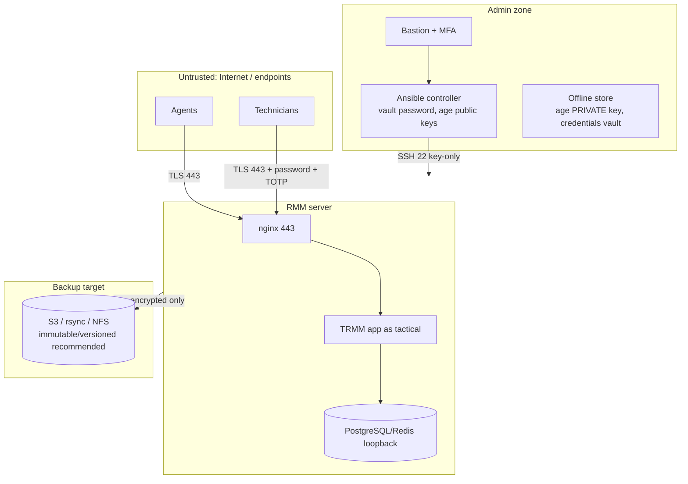

# Architecture

## Components (TRMM v1.6.1 standard install)

| Component | Unit | Runs as | Listens | Notes |
|---|---|---|---|---|
| nginx (nginx.org repo) | `nginx.service` | root master, `www-data` workers | 0.0.0.0/[::]:443 (+80 redirect) | TLS termination for `rmm`, `api`, `mesh`; serves `/static` from `/rmm/api/tacticalrmm/static` |
| Django API (uwsgi) | `rmm.service` | `tactical` (group `www-data`) | unix socket | `/rmm/api/tacticalrmm` |
| Websockets (uvicorn) | `daphne.service` | `tactical` | `/rmm/daphne.sock` | |
| NATS server | `nats.service` | `tactical` | **127.0.0.1**:4222, 127.0.0.1:9235 (ws) | Agents connect through nginx at `wss://api…/natsws` |
| NATS API bridge | `nats-api.service` | `tactical` | – | |
| Celery / beat | `celery.service`, `celerybeat.service` | `tactical` | – | logs in `/var/log/celery` |
| MeshCentral | `meshcentral.service` | `tactical` | 4430 (+800), `tlsOffload: 127.0.0.1` | proxied by nginx at `mesh…` |
| PostgreSQL 18 (PGDG) | `postgresql.service` | `postgres` | 127.0.0.1:5432 | DBs `tacticalrmm`, `meshcentral` |
| Redis | `redis-server.service` | `redis` | 127.0.0.1:6379 | |

Added by this repository:

| Unit / file | Purpose |
|---|---|
| `trmm-backup.timer` / `.service` (`tactical`) | Nightly: download the latest official `backup.sh`, run it, age-encrypt, ship off-host, apply retention |
| `trmm-healthcheck.timer` | Five-minute health check: services, HTTPS, certificate expiry, backup age, disk. Writes syslog and Prometheus textfile output |
| `certbot.timer` + `/etc/letsencrypt/renewal-hooks/deploy/50-trmm.sh` | DNS-01 renewal; copies the certificate to `/etc/ssl/trmm/` and restarts nginx, meshcentral, rmm and daphne |
| `audit-log-archive.timer` | Compresses rotated audit logs and prunes after 90 days |
| `/etc/sudoers.d/50-trmm-tactical` | NOPASSWD sudo for the service account (EXC-02) |
| `/etc/ssh/sshd_config.d/10-baseline.conf`, `00-cis-sshd.conf` | SSH policy |

## Trust boundaries



- **Endpoints → server:** only TCP 443. TLS 1.2/1.3 is configured by the installer's nginx configuration. Agents authenticate with per-agent credentials. Technicians use a password plus TOTP.
- **Admin → server:** SSH from `admin_ssh_cidrs` only, key-only, restricted to the `sshlogin` group. sudo requires the admin's password (`tactical` has no password and cannot log in over SSH).
- **Server → backup target:** archives are encrypted with **age public keys** before they leave the host. The private key is never on the server, so a compromised server or backup bucket cannot decrypt old backups.
- **Secrets:** `vault.yml` (ansible-vault) holds sudo/GRUB/SMTP/DNS-API/backup credentials. Credentials generated during install go **only** to `credentials/<host>.vault.yml`, encrypted on the controller with the `ansible.builtin.vault` filter. Plaintext never touches the controller's disk, and the expect task runs with `no_log`.

## Execution order and why

```
01-baseline  ->  02-trmm-install  ->  [audit before]  ->  03-cis-level1  ->  04-verify  ->  [audit after]
```

`install.sh` compiles Python 3.12 from source and creates databases with
`sudo -iu postgres`. CIS hardening adds `noexec` on `/tmp`, sets `nologin`
for system accounts (5.4.2.7, including `postgres`), applies umask 027 and
restricts cron. Installing first and hardening second avoids all of these
conflicts without exceptions. `roles/cis_level1` refuses to run before TRMM
is installed. Restores always target a fresh, un-hardened VM for the same
reason.

## File locations

| Path | Content | Backed up by `backup.sh` |
|---|---|---|
| `/rmm` | TRMM code, venv, `local_settings.py` (DB credentials, secret key) | settings file |
| `/meshcentral` | MeshCentral code + data | yes (excl. node_modules, recordings) |
| `/etc/ssl/trmm/{fullchain,privkey}.pem` | TLS certificate used by nginx/TRMM (`CERT_FILE`/`KEY_FILE`) | yes (custom certs) |
| `/etc/letsencrypt` | certbot state, DNS credentials, deploy hook | yes |
| `/opt/tactical` | reporting assets | yes |
| `/rmmbackups` | local encrypted backups (7 days) | – |
| `/var/lib/trmm-backup` | backup state (`last_success`, backup.sh hash) | – |
| `/var/log/audit/archive` | compressed rotated audit logs (90 days) | – |
